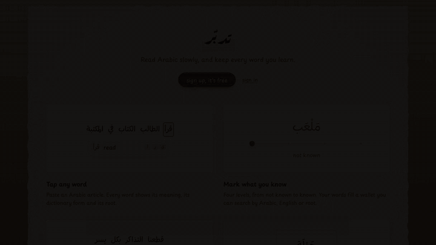

# Tadabbur (تدبّر)

**Read Arabic slowly, and keep every word you learn.**

Try it: **[tadabburi.netlify.app](https://tadabburi.netlify.app)** (free, sign up with an email and password)

[Watch the video in full quality](docs/tadabbur.mp4)

## What you can do

- **Tap any word.** Paste an Arabic article and every word shows its meaning, its dictionary form and its root. Each sentence has an English translation and can be read aloud.
- **Mark what you know.** Four levels, from *not known* to *known*. Your words collect in a wallet you can search in Arabic (with or without vowels), in English, or by root.
- **Keep phrases and notes.** Drag across any run of words to save it as a phrase, with its meaning and your own note. It stays underlined in the text.
- **Review a little each day.** Words and phrases come back as flashcards when they are due, and a daily streak keeps you going.
- **Read your way.** One sentence at a time or the whole text, with larger or smaller Arabic, on a computer or a phone.

## How to start

1. Open [tadabburi.netlify.app](https://tadabburi.netlify.app) and sign up.
2. Press **+**, paste an article (its title on the first line), and save.
3. Read: tap a word, set its level, drag across words to keep a phrase.
4. Open the **deck** each day to review.

## Made with AI

Tadabbur was built by Hussain with **Claude** (Anthropic) used heavily throughout: planning the features, designing the pages, writing most of the code, testing it in a browser, making the product video and writing this README. Hussain decided what to build and steered every step.

Inside the app, **[Fanar](https://fanar.qa)** (Qatar's Arabic AI) gives the word meanings, roots, translations and audio. For any text you can also copy a ready-made prompt into Claude and paste its answer back, for translations and meanings read in context.
